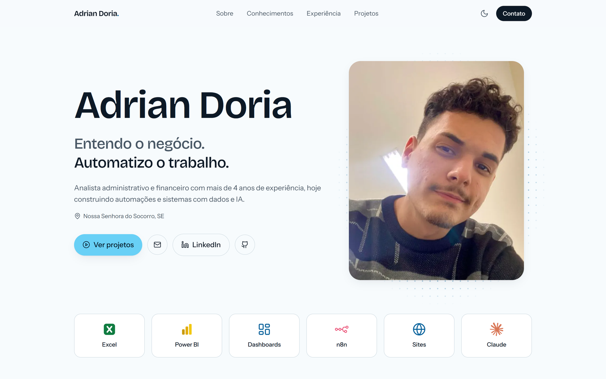

# Portfólio · Adrian Doria

**Entendo o negócio. Automatizo o trabalho.**

Meu portfólio pessoal: quem eu sou, o que eu sei fazer e os projetos que já construí. Página única, rápida, com tema claro e escuro.

### [→ Ver ao vivo](https://adrian-doria-portfolio.vercel.app)



## Destaques

- **Conhecimentos como um fluxo do n8n:** Negócio → Dados → Automação & IA. Ao entrar na tela, os nós "executam" em sequência.
- **Movimento com propósito:** frase de abertura palavra por palavra, leitura guiada no "Sobre", paralaxe leve nas telas dos projetos e inclinação sob o mouse. Tudo desliga com `prefers-reduced-motion`, e sem JavaScript o conteúdo continua visível.
- **Mobile-first**, validado em 375, 768 e 1440 px.
- **Leve:** HTML estático, um script pequeno de movimento, imagens em WebP e fontes locais.

## Stack

Astro · TypeScript · Tailwind CSS v4 · Vercel

## Como rodar

```bash
npm install
npm run dev
npm run build
```

## Onde está cada coisa

```
src/data/perfil.ts      todo o texto do site em um só lugar
src/components/         uma seção por arquivo
src/scripts/motion.ts   paralaxe, revelar ao rolar, contadores, inclinação
github/perfil/          README do meu perfil no GitHub e o gerador do banner animado
```

Feito por mim, com [Claude Code](https://claude.com/claude-code) como par de programação.
