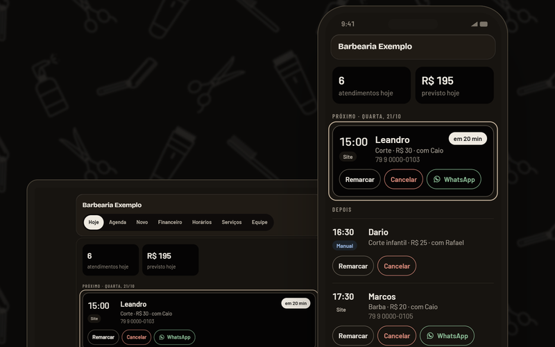
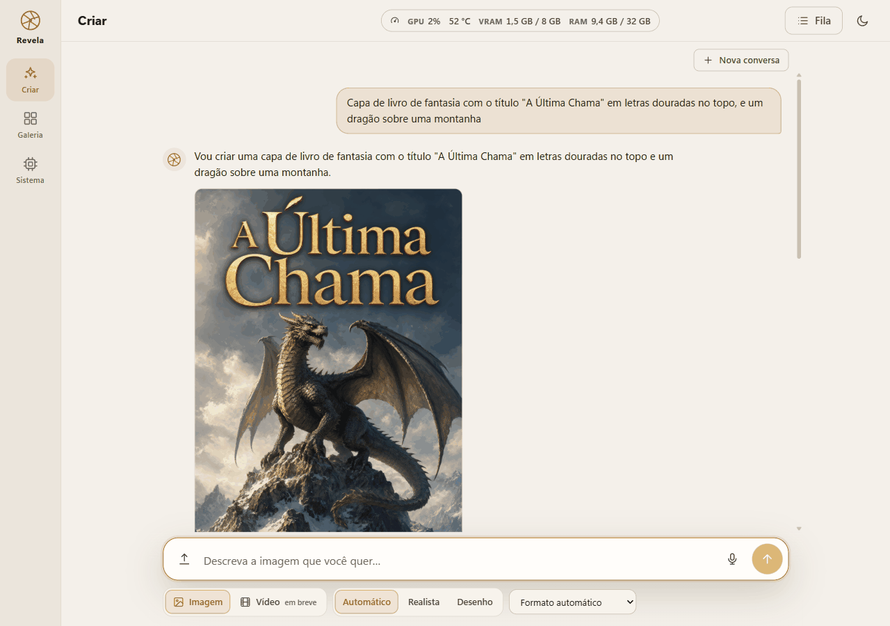

<!-- README de perfil do GitHub (repositório AdrianDoriaTI/AdrianDoriaTI). Fonte: adrian-doria-portfolio/github/perfil. Banner: python gerar-banner.py -->

<picture>
  <source media="(prefers-color-scheme: dark)" srcset="img/banner-dark.svg">
  
  <tr>
    <td width="50%" valign="top">
      
      <h3><a href="https://github.com/AdrianDoriaTI/agenda-web-pro">Agenda Web Pro</a></h3>
      <b>O que é:</b> sistema de agendamento online para barbearias. 
      <b>Objetivo:</b> o cliente marca sozinho e o barbeiro vê o dia e o financeiro. 
      <b>Como foi feito:</b> defini as regras do negócio e criei com o Claude Code, com n8n e PostgreSQL.
        
      <code>Criado com Claude Code</code> <code>n8n</code> <code>PostgreSQL</code>
    </td>
    <td width="50%" valign="top">
      
      <h3><a href="https://github.com/AdrianDoriaTI/agenda-web-pro-site">Site Agenda Web Pro</a></h3>
      <b>O que é:</b> o site que apresenta o sistema, com uma demonstração dentro da página. 
      <b>Objetivo:</b> o dono da barbearia entender e testar em poucos minutos. 
      <b>Como foi feito:</b> desenhei a página e o texto e criei com o Claude Code.
        
      <code>Criado com Claude Code</code> <code>Astro</code>
        
      <a href="https://www.agendawebpro.com.br/site/barbearias/">Ver ao vivo →</a>
    </td>
  </tr>
</table>

### [Revela](https://github.com/AdrianDoriaTI/revela)
**O que é:** gerador de imagens com IA que funciona no próprio computador, em português.
**Objetivo:** criar imagens conversando, sem assinatura e sem enviar nada para a nuvem.
**Como foi feito:** defini como deveria funcionar e criei com o Claude Code, usando modelos de IA locais.

<code>Criado com Claude Code</code> <code>IA local</code> <code>ComfyUI</code>

E o próprio **[portfólio](https://github.com/AdrianDoriaTI/adrian-doria-portfolio)**, desenhado por mim e construído com o Claude Code.

## Conhecimentos

| Administrativo e financeiro | Automação e IA |
|---|---|
| Análise financeira e controle orçamentário | Fluxos no n8n e integrações |
| Capex e Opex, provisões | Projetos criados com Claude Code |
| ERP SAP, compras e notas fiscais | Agentes de IA |
| Excel, Power BI e dashboards | PostgreSQL e regras de negócio |

## Objetivo

Busco oportunidades em administrativo e financeiro, principalmente onde a automação de processos faça diferença.
