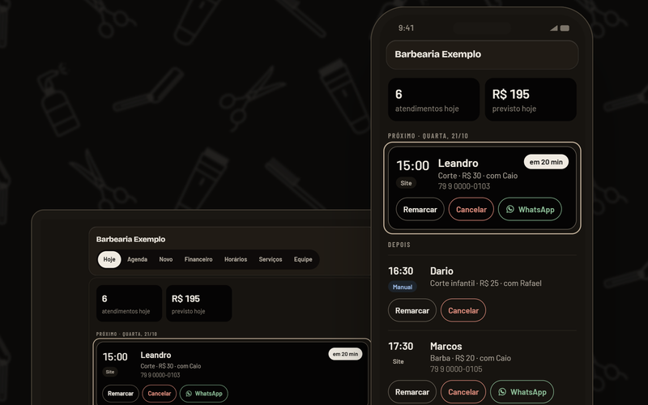

<!-- README de perfil do GitHub (repositório AdrianDoriaTI/AdrianDoriaTI). Fonte: adrian-doria-portfolio/github/perfil. Banner: python gerar-banner.py -->

<picture>
  <source media="(prefers-color-scheme: dark)" srcset="img/banner-dark.svg">
  
</picture>

Sou analista administrativo e financeiro, com mais de 4 anos em compras, notas fiscais, controle orçamentário, Capex e Opex e SAP. Nesse dia a dia percebi quanto tempo vai embora em tarefas repetitivas, então me formei em Análise e Desenvolvimento de Sistemas e passei a estudar automação de processos e IA.

Hoje eu construo com essas ferramentas. Os projetos estão logo abaixo, e você pode ver cada um funcionando.

**[Portfólio](https://adrian-doria-portfolio.vercel.app)** · **[LinkedIn](https://www.linkedin.com/in/adriandoria454)** · **[E-mail](mailto:adrian.doria454@outlook.com)**

## O que eu já construí

<table>
  <tr>
    <td width="50%" valign="top">
      
      <h3><a href="https://github.com/AdrianDoriaTI/agenda-web-pro">Agenda Web Pro</a></h3>
      Agenda online para barbearias, do horário marcado ao financeiro do dia. A disponibilidade é decidida pelo banco de dados, então nunca há horário duplicado.
        
      <code>PostgreSQL</code> <code>n8n</code> <code>JavaScript</code>
        
      <a href="https://www.agendawebpro.com.br/site/barbearias/#demonstracao">Ver ao vivo →</a>
    </td>
    <td width="50%" valign="top">
      
      <h3><a href="https://github.com/AdrianDoriaTI/agenda-web-pro-site">Site Agenda Web Pro</a></h3>
      A vitrine do produto, com o sistema funcionando dentro da página. Tema claro e escuro e cabeçalhos de segurança.
        
      <code>Astro</code> <code>TypeScript</code> <code>Tailwind</code> <code>Cloudflare</code>
        
      <a href="https://www.agendawebpro.com.br/site/barbearias/">Ver ao vivo →</a>
    </td>
  </tr>
</table>

E o próprio **[portfólio](https://github.com/AdrianDoriaTI/adrian-doria-portfolio)**, feito por mim do design ao código.

## O que eu sei fazer

| Negócio e dados | Automação e IA |
|---|---|
| Controle orçamentário, Capex e Opex, provisões | Fluxos no n8n e integrações por API |
| ERP SAP, compras e notas fiscais | Agentes de IA no WhatsApp |
| Excel, Power BI e relatórios gerenciais | PostgreSQL e regras de negócio no banco |
| SQL | Sites com Astro, TypeScript e Claude Code |

## Agora

Estudando automação de processos e IA aplicada a finanças. Procuro uma vaga em que eu una o administrativo e financeiro com automação.
